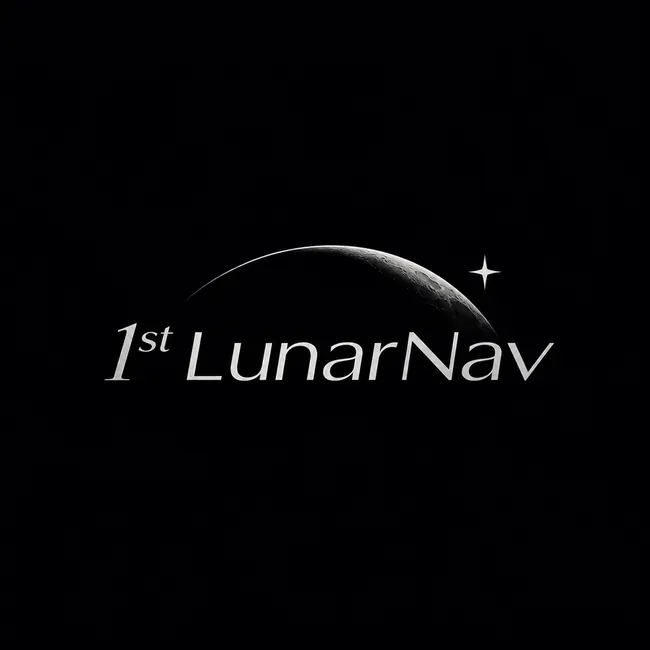

<div align="center">



# LunarNav

**Explore the Moon. Understand the terrain. Plan the mission.**

An interactive lunar mission-planning experience created for the **NASA Space Apps Challenge 2026** by **Team 1st LunarNav**.

[**Launch LunarNav**](https://lunarnav-v2.vercel.app/) · [Explore the Moon](https://lunarnav-v2.vercel.app/explore) · [Our Space Apps team](https://www.spaceappschallenge.org/2026/find-a-team/1st-lunarnav/)

</div>

---

## The idea

A place on the Moon can look perfect on a map and still be a difficult place to operate. Near the lunar south pole, low Sun angles and surrounding terrain create long shadows, while Earth visibility affects opportunities for direct communication.

**LunarNav brings those questions into one interactive workspace.** Choose a site, set a UTC mission period, inspect the Sun and Earth against the local horizon, compare possible windows, and explore what the conditions could mean for an early-stage mission design.

It is built for exploration, learning, and **first-pass mission screening**—not for certifying a landing site.

## What you can do

| Workspace | Capabilities |
| --- | --- |
| **Explore** | Navigate an interactive 3D Moon, select one of five study locations or choose a custom waypoint, and inspect conditions over time. |
| **Plan Mission** | Compare sites and mission periods using illumination, darkness, Earth visibility, communication gaps, simultaneous visibility, and reference solar-energy metrics. |
| **Engineering** | Explore simplified solar-array, power-load, and battery estimates, terrain refinement, and approximate surface travel distances. |
| **Methods** | Understand the models, data sources, terrain resolution, assumptions, and limitations behind the results. |

### Highlights

- **Interactive lunar globe:** Rotatable WebGL Moon with real elevation-derived relief and adjustable graphics quality.
- **Your site, your timeframe:** Five preset south-polar study locations, custom coordinates, UTC date/time selection, and mission duration controls.
- **Sun and Earth visibility:** Local sky diagram, visibility timeline, and azimuth-dependent terrain-horizon checks when suitable elevation data is loaded.
- **Mission-window finder:** Search candidate dates, rank site/window combinations by solar access, Earth visibility, or a balanced score, and open recommended windows in Explore.
- **Site comparison:** Inspect six planning metrics side by side, including the effects of different mission dates.
- **Terrain-aware exploration:** Use bundled lunar relief, refine local horizons with supported NASA elevation sources, and inspect a 360° terrain panorama from a selected waypoint.
- **Engineering sandbox:** Estimate reference solar energy and idealized battery behavior; explore approximate surface-traverse and Earth-to-Moon transit timing.
- **Shareable results:** Export CSV data, generate mission briefings suitable for printing or saving as PDF, and share links to preset-site scenarios.
- **Ask Spacey AI:** An optional Gemini-powered assistant that can use the selected mission context and the application's analysis tools.
- **Guided onboarding:** A replayable 12-step tour that introduces the major features.

## Try it

**Live application:** https://lunarnav-v2.vercel.app/

1. Open **Explore** and select **Mons Mouton**, **Malapert Region**, **Shackleton Rim**, **Faustini Rim**, or **Nobile Region**. You can also choose your own waypoint on the globe.
2. Choose a UTC start date, time, and mission duration.
3. Inspect the Moon, Sun/Earth positions, local sky, and visibility timeline.
4. Open **Plan Mission** to compare locations or search for more favorable dates.
5. Use **Engineering** for first-order power and travel scenarios, then export a briefing.

> **About the preset sites:** They are a mixture of a documented landing location, reference coordinates, an approximate historical candidate, and illustrative study points. They are **not** five independently certified landing sites. The app identifies their provenance.

## Run locally

**Requirements:** Node.js **22.13+** and npm. Node.js 24 is also tested.

```bash
git clone https://github.com/adamjamiesimson/LunarNav-V2.git
cd LunarNav-V2

npm ci
npm run dev
```

Open **http://localhost:4173**.

The local development server serves the web application and asset proxies. The Gemini assistant requires a separately configured server-side API endpoint.

### Build and checks

```bash
npm test                       # Syntax and project checks
npm run build                  # Create the production site in dist/
npm run preview                # Serve the production build locally
```

For the desktop/mobile Chromium smoke checks, after building:

```bash
npx playwright install chromium
node scripts/browser-smoke.mjs
```

Additional developer commands are available in `package.json`, including terrain-source and horizon validation utilities.

## Optional AI assistant

**Ask Spacey AI** uses the Google Gemini SDK through the server-side `api/chat.js` endpoint. The core lunar explorer, planner, and engineering models are separate from the assistant.

Configure these environment variables on your server or Vercel deployment:

```dotenv
GEMINI_API_KEY=your_server_side_key
GEMINI_MODEL=gemini-3.8-flash
```

`GEMINI_MODEL` is optional; fallback models can be configured with `GEMINI_FALLBACK_MODELS`. See [`.env.example`](./.env.example).

**Never put a Gemini API key into client-side JavaScript or commit it to Git.** Without a configured API endpoint, the assistant is unavailable, but the rest of the application can still be used.

## How the analysis works

LunarNav combines lightweight astronomical calculations with elevation-based horizon modeling.

1. **Celestial geometry:** `src/astro.js` estimates Sun and Earth directions in a Moon-fixed frame using truncated series and IAU 2015 lunar rotation conventions.
2. **Terrain horizons:** Bundled NASA-derived elevation grids and site horizon profiles describe how nearby terrain may obstruct a body at a given azimuth. Supported source-data refinement can improve local profiles within an approximately 20 km radius.
3. **Visibility:** A body is counted as visible when its **center** is above the modeled local horizon. Without a loaded terrain profile, the baseline is a flat **0° geometric horizon**.
4. **Window screening:** The app samples visibility across candidate mission periods and derives metrics for sunlight, darkness, Earth access, interruptions, and simultaneous Sun/Earth visibility.
5. **Engineering scenarios:** Reference solar-array, constant-load, ideal-battery, and spherical-distance calculations turn those geometric results into exploratory planning estimates.

Window ranking generally uses **4-hour samples**; mission comparisons use **2-hour samples**. These are discretely sampled screening results, not exact event predictions.

### Data and references

The project draws on or references:

- [NASA LOLA / Planetary Geology, Geophysics and Geochemistry Laboratory](https://pgda.gsfc.nasa.gov/products/90) — lunar elevation and south-polar terrain.
- [SLDEM2015](https://imbrium.mit.edu/) — lunar digital elevation data used in the global relief pipeline.
- [NASA Scientific Visualization Studio](https://svs.gsfc.nasa.gov/4720/) — Lunar Reconnaissance Orbiter color imagery.
- [NASA Planetary Data System](https://pds.nasa.gov/) — landing-site reference and mission information.
- [JPL Horizons](https://ssd.jpl.nasa.gov/horizons/) and [NAIF SPICE](https://naif.jpl.nasa.gov/naif/) — relevant external references for lunar mission geometry.
- [IAU Working Group on Cartographic Coordinates and Rotational Elements](https://doi.org/10.1007/s10569-017-9805-5) — lunar rotation conventions.

The application **does not use a full SPICE ephemeris or a live JPL Horizons solution** for its core browser calculations. The **Methods** workspace documents additional provenance and technical details.

## Project structure

```text
LunarNav-V2/
├── api/
│   └── chat.js              # Optional server-side Gemini assistant
├── assets/                  # Images and application assets
├── data/                    # Bundled lunar relief and horizon data
├── scripts/                 # Build, preview, validation, and smoke checks
├── src/
│   ├── astro.js             # Lunar/Sun/Earth geometry
│   ├── globe.js             # WebGL lunar globe
│   ├── finder.js            # Mission-window ranking
│   ├── router.js            # Application routes
│   └── ...                  # Planning, terrain, engineering, and UI modules
├── index.html               # Application entry point
├── package.json
└── vercel.json              # Deployment and data-source rewrites
```

**Stack:** JavaScript ES modules, HTML/CSS, WebGL/GLSL, Node.js tooling, Vercel, and the optional Google Gemini SDK. Automated browser checks use Playwright.

## Important limitations

LunarNav is a **research and educational prototype**, not flight software or a mission-approval system.

- Astronomical positions are approximate; they do not include every effect modeled by high-precision ephemerides.
- Local terrain horizons have finite spatial resolution and reach; small hazards, boulders, distant obstructions, and incomplete coverage can be missed.
- Sun/Earth visibility is geometric. It is **not** a radio link budget or a guarantee of communications, power generation, or landing safety.
- The power model uses a horizontal solar array, a constant electrical load, and an ideal battery. It does not simulate detailed thermal behavior, degradation, or battery chemistry.
- Travel estimates use spherical distances, not traversable paths through real obstacles or slopes.
- Simplified time sampling can miss short visibility events. Imported terrain may be unverified, and the app labels such sources.

**Do not use these estimates as the sole basis for operational mission decisions.**

## Team

Made for the **NASA Space Apps Challenge 2026** by **Adam Simson** and **Ankush Dutta**, **Team 1st LunarNav**.

[View our NASA Space Apps team page](https://www.spaceappschallenge.org/2026/find-a-team/1st-lunarnav/)

---

<div align="center">

**The Moon is complicated. Exploring it shouldn't have to be.**

[**Open LunarNav**](https://lunarnav-v2.vercel.app/)

<sub>Independent NASA Space Apps Challenge project. Not affiliated with or endorsed by NASA.</sub>

</div>
